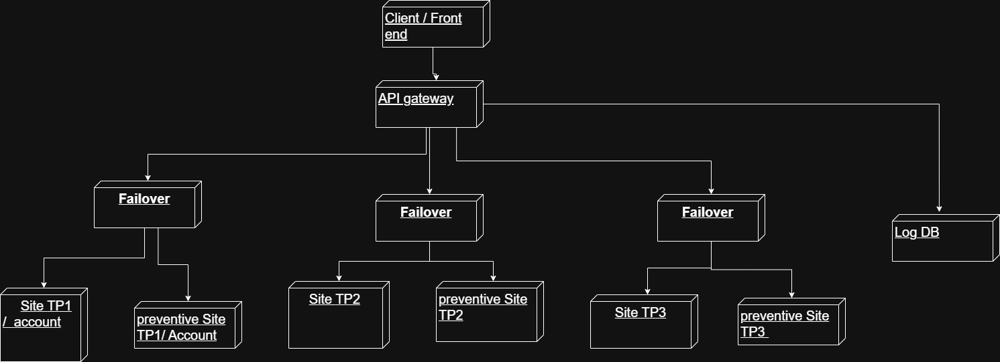

# Distributed Electricity Management System 

A distributed database management system for electricity services built on a multi-platform **Distributed Database (CSDLPT)** architecture combining **Microsoft SQL Server** and **PostgreSQL**. The project includes a **Node.js/Express REST API**, **Java Swing Desktop Applications**, **automatic database failover and recovery**, **centralized logging with Grafana Loki**, and **AI-assisted SQL replay script generation via Ollama**.

---

## System Architecture



### 1. Database Fragmentation and Replication

Data is horizontally partitioned across three regional shards (**TP1**, **TP2**, **TP3**), each paired with a dedicated backup server (**SV4**, **SV5**, **SV6**):

| Shard | Region | DBMS | Primary Databases | Backup Server |
| :--- | :--- | :--- | :--- | :--- |
| **TP1** | Hanoi | SQL Server (Local) | `DienLuc` and `UsersCsdlPt` | **SV4** (Somee MSSQL) |
| **TP2** | Da Nang / Cloud | SQL Server (Somee) | `csdlpt_lab2` (shared for `DienLuc` and `Users`) | **SV5** (Somee MSSQL / PostgreSQL) |
| **TP3** | Ho Chi Minh City | PostgreSQL (Supabase) | `postgres` (`public` schema) | **SV6** (Somee MSSQL) |

### 2. Core Database Entities

Each shard stores its regional slice of the electricity domain tables:
- `chinhanh` (`maCN`, `tenCN`, `thanhpho`): Regional branches.
- `nhanvien` (`maNV`, `hoten`, `maCN`): Staff members assigned to a branch.
- `khachhang` (`maKH`, `tenKH`, `maCN`): Customers registered at a branch.
- `hopdong` (`soHD`, `ngayKy`, `maKH`, `soDienKe`, `kwDinhMuc`, `dongiaKW`, `isPaid`): Electricity meter contracts and payment status.
- `hoadon` (`soHDN`, `thang`, `nam`, `soHD`, `maNV`, `soTien`): Monthly electricity bills issued by staff.

Authentication and cross-branch transfer tracking tables (`UsersCsdlPt`):
- `Users` (`MaNV`, `Email`, `Password`, `Role`, `Salt`): User credentials hashed with SHA-512 and per-user salt.
- `lichSuChuyenCongTac` (`id`, `MaNV`, `MaKH`, `NgayChuyen`, `maCNCu`, `maCNMoi`): Audit log of staff transfers across branches and cities.

### 3. Failover, Health Check, and Backup Synchronization

- **Backend Automatic Failover (`src/Config/DBConnection.js`)**: If **TP1** or **TP2** fails to connect, the pool manager automatically switches to **SV4** or **SV5** respectively and starts a background health check every 30 seconds. Once the primary server comes back online, traffic automatically switches back.
- **Desktop Failover & Changelog Sync (`CSDLPT_FrontEnd/src/csdlpt/DatabaseConnection.java`, `BackupSyncService.java`)**:
  - Supports failover from **TP1 -> SV4**, **TP2 -> SV5**, and **TP3 -> SV6**.
  - Records `INSERT`, `UPDATE`, and `DELETE` operations performed on backup servers into `_backup_changelog` and replays them to primary servers upon recovery.

---

## Project Structure

```text
DoAnCSDLPT/
├── server.js                  # Express backend entry point (default port: 9999)
├── swagger.js                 # OpenAPI 3.0 / Swagger UI configuration (/api-docs)
├── resetAdminPassword.js      # CLI utility to reset the Admin password in UsersCsdlPt
├── Admin/
│   ├── AddSite.js             # Create new branch on the target city shard
│   ├── Count.js               # Aggregate counts (branches, customers, staff) across all shards
│   ├── History.js             # Fetch staff branch transfer history
│   ├── Sites.js               # List, update, and delete branches across shards
│   └── Staffs.js              # List, create, delete, and transfer staff across branches/cities
├── Staff/
│   ├── AllInformation.js      # Retrieve staff profile and assigned branch details
│   ├── Contract.js            # List and create electricity contracts (ULID-generated IDs)
│   ├── Customers.js           # List, add (with cross-shard unpaid contract check), and update customers
│   └── bills.js               # Issue bills (ULID-generated IDs), mark contracts paid, list bills
├── Question/
│   └── Question.js            # Distributed analytical queries (cau1, cau2)
├── src/
│   ├── Config/
│   │   ├── DBConnection.js    # Connection pools for TP1, TP2, TP3, SV4, SV5 & failover logic
│   │   ├── QueryHelper.js     # Translates MSSQL parameterized queries (@param) to PostgreSQL ($1)
│   │   └── logger.js          # Winston DailyRotateFile JSON logger partitioned by TP1, TP2, TP3
│   ├── Middleware/
│   │   └── verifyToken.js     # JWT verification middleware
│   └── Route/
│       └── Login.js           # Login endpoint (SHA-512 + salt verification, JWT issuance)
├── CSDLPT_FrontEnd/           # Primary Java Swing desktop client (direct JDBC to shards & backups)
├── CSDLPT/                    # Initial Java Swing UI version
├── scripts/                   # SQL initialization, user setup, and stored procedure scripts
├── data/                      # SQL Server database files (.mdf, .ldf) for TP1, TP2, TP3
├── loki-logging/              # Docker Compose stack (Loki, Promtail, Grafana), logs, and SQL replays
├── AI/
│   └── generateSQL.js         # Reads JSON logs and calls Ollama (qwen2.5-coder) to generate SQL replay
├── test/                      # Connection and logger verification scripts
├── SUPABASE_GUIDE.md          # Supabase PostgreSQL (TP3) setup and query guide
└── SWAGGER_EXAMPLES.md        # Sample API requests and responses
```

---

## Tech Stack

- **Backend**: Node.js, Express 5, `mssql`, `pg`, `jsonwebtoken`, `crypto` (SHA-512), `bcrypt`, `ulid`, `winston`, `winston-daily-rotate-file`, `swagger-jsdoc`, `swagger-ui-express`, `cors`, `dotenv`.
- **Desktop Frontend**: Java Swing (JDK 8+/11+, NetBeans/Ant), JDBC (`mssql-jdbc`, `postgresql`).
- **Databases**: Microsoft SQL Server (Local & Somee Cloud), PostgreSQL (Supabase).
- **Logging & Monitoring**: Docker Compose, Grafana Loki 2.9.0, Promtail 2.9.0, Grafana.
- **AI Log Replay**: Ollama local LLM (`qwen2.5-coder`).

---

## Prerequisites

- **Node.js** (v18+ recommended)
- **Java JDK** 11+ (for `CSDLPT_FrontEnd`)
- **Microsoft SQL Server** (local instance for TP1) and **Somee / Supabase** instances (for cloud shards and backups)
- **Docker & Docker Compose** (optional, for Loki/Grafana log aggregation)
- **Ollama** with the `qwen2.5-coder` model pulled (optional, for AI SQL replay generation)

---

## Setup and Configuration

### 1. Database Initialization

Execute the SQL scripts in `scripts/` against their corresponding servers:
- Primary shards: `setup_server1_hanoi.sql`, `setup_server2_danang.sql`, `setup_server3_hcm.sql`
- Backup servers: `setup_server4_backup_tp1.sql`, `setup_server5_backup_tp2.sql`, `setup_server6_backup_tp3.sql`
- User management tables: `setup_userscsdlpt_tp1.sql`, `setup_userscsdlpt_tp2.sql`, `setup_userscsdlpt_tp3.sql`

Refer to [SUPABASE_GUIDE.md](SUPABASE_GUIDE.md) for detailed instructions on configuring PostgreSQL on Supabase (TP3).

### 2. Environment Variables (`.env`)

Create or update `.env` in the project root with the following configuration:

```env
port_serverNode=9999
JWT_SECRET=your_jwt_secret_key

# TP1 - Local SQL Server (DienLuc & UsersCsdlPt)
DB_Server1_Type=mssql
DB_Server1=192.168.56.1
DB_Server1_Port=1433
DB_User1_DienLuc=sa
DB_Password1_DienLuc=your_password
DB_Name1_DienLuc=DienLuc

DB_Server1_Type_Users=mssql
DB_Server1_Users=192.168.56.1
DB_Server1_Port_Users=1433
DB_User1_Users=sa
DB_Password1_Users=your_password
DB_Name1_Users=UsersCsdlPt

# TP2 - Somee SQL Server
DB_Server2_Type=mssql
DB_Server2=your_tp2_host
DB_Server2_Port=1433
DB_User2=your_user
DB_Password2=your_password
DB_Name2=your_db

# TP3 - Supabase PostgreSQL
DB_Server3_Type=postgres
DB_Server3=your_supabase_host
DB_Server3_Port=6543
DB_User3=your_user
DB_Password3=your_password
DB_Name3=postgres
DB_Supabase_Schema=public

# User Database (TP2)
DB_UserManage_Type=mssql
DB_UserManage_Server=your_user_db_host
DB_UserManage_Port=1433
DB_UserManage_User=your_user
DB_UserManage_Password=your_password
DB_UserManage_Name=your_db

# SV4 - Backup TP1 & SV5 - Backup TP2
DB_Server4_Type=mssql
DB_Server4=your_sv4_host
DB_Server4_Port=1433
DB_User4=your_user
DB_Password4=your_password
DB_Name4=your_db

DB_Server5_Type=mssql
DB_Server5=your_sv5_host
DB_Server5_Port=1433
DB_User5=your_user
DB_Password5=your_password
DB_Name5=your_db
```

---

## Running the Project

### 1. Backend API (Node.js)

```bash
npm install
node server.js
```

- API Base URL: `http://localhost:9999`
- Swagger UI Documentation: `http://localhost:9999/api-docs`
- Failover Status Endpoint: `http://localhost:9999/failover-status`

Verify connectivity to all configured database pools:
```bash
node test/testConnectAll.js
```

Reset the default Admin password if needed:
```bash
node resetAdminPassword.js
```

### 2. Desktop Frontend (`CSDLPT_FrontEnd`)

1. Place `mssql-jdbc` and `postgresql` JDBC driver JARs inside `CSDLPT_FrontEnd/lib/`.
2. Verify connection URLs and credentials in `CSDLPT_FrontEnd/src/csdlpt/DatabaseConnection.java`.
3. Open `CSDLPT_FrontEnd` in NetBeans and run the project (`F6`), or build via Ant. See [CSDLPT_FrontEnd/SETUP.md](CSDLPT_FrontEnd/SETUP.md) and [CSDLPT_FrontEnd/QUICK_START.md](CSDLPT_FrontEnd/QUICK_START.md) for CLI instructions.

### 3. Centralized Logging (Loki + Promtail + Grafana)

The backend writes daily rotated JSON logs (`TP1-YYYY-MM-DD.log`, `TP2-YYYY-MM-DD.log`, `TP3-YYYY-MM-DD.log`) with custom levels (`insert`, `update`, `delete`, `info`, `warn`, `error`) to `D:/loki-logging/logs` (configured in `src/Config/logger.js`).

Start the monitoring stack:
```bash
cd loki-logging
docker-compose up -d
```
- **Loki**: `http://localhost:3200`
- **Grafana**: `http://localhost:3300`

### 4. AI SQL Replay Generator (Ollama)

Converts JSON mutation logs recorded after a given backup timestamp into T-SQL replay scripts using Ollama (`qwen2.5-coder`).

Ensure `ollama serve` is running, then execute:
```bash
cd AI
npm install
node generateSQL.js TP1 2025-11-26 13:00:00
```
Generated SQL scripts are written to `D:/loki-logging/ai-sql-output/<CITY>/<CITY>-<DAY>-replay.sql`.

---

## API Endpoints Overview

All protected routes require a JWT token in the `Authorization` header (obtained from `POST /login`).

### System & Authentication
| Method | Endpoint | Description |
| :--- | :--- | :--- |
| `GET` | `/` | Health check confirming the Node.js server is running |
| `GET` | `/failover-status` | Returns current primary/backup status for `tp1`, `tp2`, and `tp3` |
| `POST` | `/login` | Authenticates email and password (SHA-512 + salt), returns JWT token and role |
| `GET` | `/login/protected` | Sample protected route for verifying JWT authentication |

### Admin (`/admin`)
| Method | Endpoint | Description |
| :--- | :--- | :--- |
| `GET` | `/admin/CountSite` | Total branch count across all 3 shards |
| `GET` | `/admin/CountCustomer` | Total customer count across all 3 shards |
| `GET` | `/admin/CountStaff` | Total staff count across all 3 shards |
| `POST` | `/admin/addsite` | Add a new branch to the shard matching `thanhpho` (`TP1`, `TP2`, or `TP3`) |
| `GET` | `/admin/sites` | List all branches across all shards |
| `PUT` | `/admin/sites/:id` | Update branch name on the specified city shard |
| `DELETE` | `/admin/sites/:id` | Delete a branch if no staff or customers are assigned to it |
| `GET` | `/admin/staffs` | List all staff across all shards |
| `POST` | `/admin/staffs` | Create a staff record on the target shard and a user account in `UsersCsdlPt` |
| `PUT` | `/admin/staffs/:id` | Transfer staff between branches/cities and log to `lichSuChuyenCongTac` |
| `DELETE` | `/admin/staffs/:id` | Delete a staff user account from `UsersCsdlPt` |
| `GET` | `/admin/historyRecords` | Fetch all staff transfer records from `lichSuChuyenCongTac` |

### Employee (`/employee`)
| Method | Endpoint | Description |
| :--- | :--- | :--- |
| `GET` | `/employee/allInformation` | Get staff member name, branch name, branch code, and city by `maNV` |
| `GET` | `/employee/customers` | List customers belonging to the same branch as `maNV` |
| `POST` | `/employee/customers` | Add a customer after verifying no unpaid contracts exist across any shard |
| `PUT` | `/employee/customers/:id` | Update customer details |
| `GET` | `/employee/contracts` | List contracts for customers in the staff member's branch |
| `POST` | `/employee/contracts` | Create a new contract with a ULID `soHD` on the target city shard |
| `GET` | `/employee/bills` | List bills issued by `maNV` |
| `POST` | `/employee/bills` | Issue a bill with a ULID `soHDN` and mark the contract `isPaid = 1` |

### Analytical Queries (`/question`)
| Method | Endpoint | Description |
| :--- | :--- | :--- |
| `GET` | `/question/cau1` | Query bills (`soHDN`, `thang`, `nam`, `soTien`) filtered by `maNV` and `maKH` across all shards |
| `GET` | `/question/cau2` | Query bills where consumed kWh (`soTien / donGiaKW`) exceeds `kwDinhMuc` across all shards |
